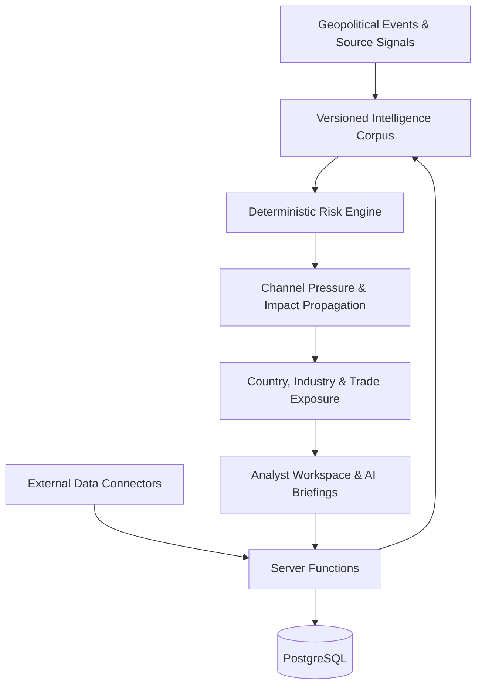

# GlobalMatrix
### Geopolitical & Supply-Chain Exposure Intelligence

**GlobalMatrix transforms geopolitical events into traceable supply-chain risk assessments.**

Tariffs, sanctions, export controls, conflicts, and shipping disruptions rarely affect one country or industry in isolation. GlobalMatrix connects these events to economic channels, countries, industries, and trade flows to help analysts and businesses understand **what changed, how the impact may propagate, and where exposure could emerge.**

## Core Capabilities

- **Geopolitical Event Intelligence** — Explore events, countries, industries, trade flows, markets, and risk scenarios.
- **Impact Propagation Engine** — Trace modeled risk across interconnected economic relationships.
- **Evidence Provenance** — Track source attribution, timestamps, reliability indicators, and corroborating signals.
- **Deterministic Risk Assessment** — Calculate channel pressure and 30/90-day risk scores using configurable analytical weights.
- **Personalized Intelligence Workspace** — Save watchlists, annotations, business exposure profiles, and analytical briefs.
- **AI-Assisted Briefings** — Generate structured assessments grounded in available evidence and engine outputs.
- **External Data Integrations** — Connect to World Bank, UN Comtrade, GDELT, and ECB data sources.

## How It Works

`Geopolitical Event → Evidence Signals → Channel Pressure → Impact Propagation → Exposure Assessment`

GlobalMatrix combines a versioned event corpus, source metadata, a deterministic scoring engine, and linked economic relationships to produce explainable assessments rather than opaque risk scores.

## Technology Stack

- **Frontend:** React 19, TypeScript, TanStack Router, Tailwind CSS v4, shadcn/ui
- **Backend:** TanStack Start, server functions, Cloudflare Workers
- **Database & Authentication:** PostgreSQL, Lovable Cloud, row-level security
- **AI:** Lovable AI Gateway
- **Data Sources:** World Bank, UN Comtrade, GDELT, ECB SDMX
- **Testing:** Vitest

## Getting Started

Requirements: Node.js 20+ or Bun.

```bash
git clone <YOUR_REPOSITORY_URL>
cd <YOUR_PROJECT_DIRECTORY>
bun install
bun run dev
```

Run tests and production checks:

```bash
bun run test
bunx tsgo --noEmit
bun run build
```

Configure environment variables through your deployment settings. Never commit secrets or service-role credentials.

## Architecture



## Reliability & Limitations

Risk weights are manually configured, and reported intervals are not statistically calibrated confidence intervals. Assessments should be treated as structured analytical estimates, not validated forecasts. AI briefs are interpretations, not independent verification of facts. Data freshness depends on source availability.

Company intelligence, policy analysis, and historical analogues still require further data integration.

## Roadmap

- Calibrate risk assessments through historical backtesting.
- Expand verified data coverage and economic relationship mapping.
- Develop company-level exposure intelligence.
- Strengthen automated testing and production monitoring.

---

**GlobalMatrix — From global disruption to explainable economic exposure.**
