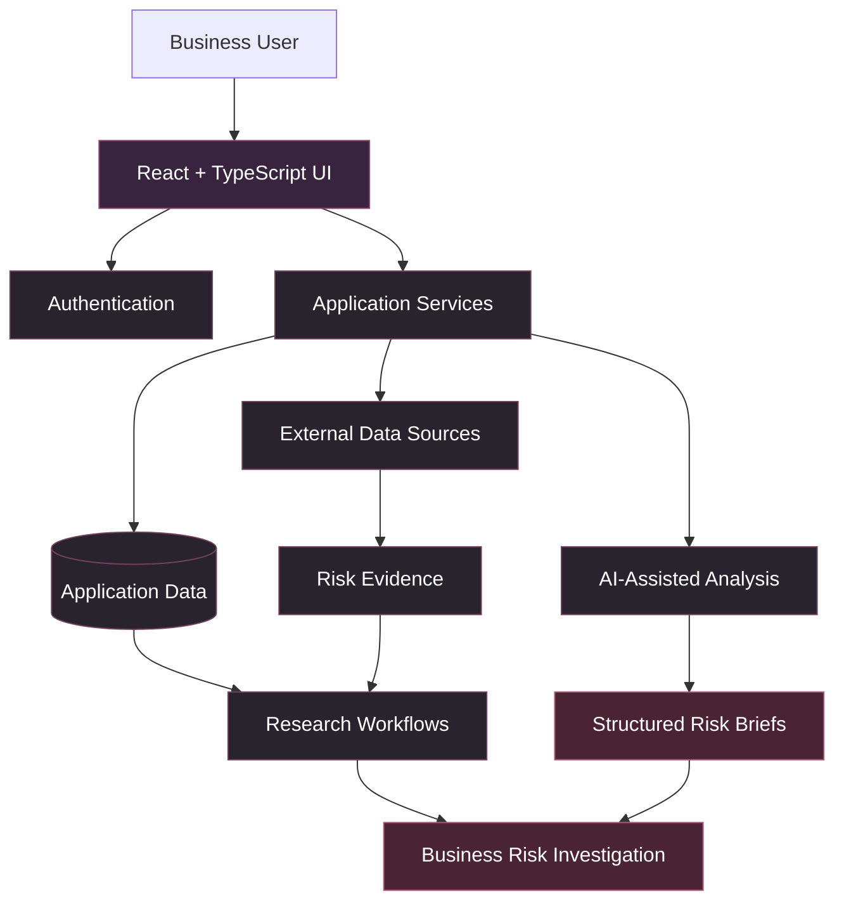

# 🌍 GlobalMatrix

### Geopolitical & Supply Chain Risk Intelligence

**From global events to business-relevant risk intelligence.**

GlobalMatrix helps businesses investigate how geopolitical developments, trade restrictions, and supply-chain disruptions may affect their operations. Its core concept, **Propagation Intelligence**, connects an originating event with potential exposures and downstream business impacts.

<p align="center">
  <a href="https://globalmatrix.dev"><strong>🚀 Live Platform</strong></a>
  ·
  <a href="#-how-it-works"><strong>How It Works</strong></a>
  ·
  <a href="#-technology-stack"><strong>Technology Stack</strong></a>
</p>

<p align="center">
  
  
  
</p>

---

## 🖥️ Product Preview

<!-- Add a genuine screenshot of the current application at docs/images/dashboard.png -->

<p align="center">
  
</p>

<p align="center"><em>Global risk intelligence designed around business exposure, evidence, and potential downstream impacts.</em></p>

> **Screenshot setup:** Capture the actual deployed application, save it as `docs/images/dashboard.png`, and commit it to the repository. Replace this image path if you use a different filename. Do not use mock dashboards or fabricated metrics.

## 🎯 The Problem

A geopolitical event rarely affects just one organization or location. A trade restriction can influence component availability, a port disruption can delay shipments, and a regional conflict can introduce uncertainty across supplier networks.

Yet the information needed to understand these relationships is often fragmented across news, trade statistics, economic indicators, and policy announcements.

**GlobalMatrix addresses a more useful question than “What happened?”**

*Why might it matter to a business, which dependencies should be investigated, and what could happen next?*

## 🧠 How It Works


### Example: Export Restrictions

<details>
<summary><strong>Explore an illustrative risk scenario</strong></summary>

1. **Event:** A government announces an export restriction on an industrial component.
2. **Exposure:** Investigate the countries, industries, and trade relationships connected to that component.
3. **Propagation:** Examine which downstream manufacturers could face supply constraints.
4. **Assessment:** Separate documented facts from potential consequences and unknowns.
5. **Next steps:** Identify supplier dependencies and sourcing questions requiring verification.

This is an illustrative workflow, not a claim that every impact is automatically detected or verified by the application.

</details>

## ✨ Core Capabilities

| Capability | Purpose |
|---|---|
| 🌍 Geopolitical risk research | Investigate events, policy changes, and potential disruptions. |
| 🕸️ Propagation Intelligence | Explore relationships between events and potential downstream impacts. |
| 🤖 AI-assisted risk briefs | Organize complex information into structured analysis. |
| 🔎 Exposure research | Investigate relevant countries, industries, and trade dependencies. |
| 📌 Watchlists and annotations | Preserve research context for ongoing investigations. |
| 🧾 Evidence-aware analysis | Emphasize source traceability, uncertainty, and analytical limitations. |

*Capabilities should be retained in this table only where they are supported by the current implementation.*

## 🏗️ System Architecture

The following diagram illustrates the high-level logical design, rather than a claim that every component runs as a separate service.



### Design priorities

- **Data provenance:** Preserve supporting sources wherever available.
- **Explainability:** Make the reasoning behind potential impacts understandable.
- **Uncertainty:** Distinguish observations from hypotheses and modeled outcomes.
- **Responsible AI:** Use generated analysis as decision support, not unquestionable fact.

## 🛠️ Technology Stack

<p align="center">
  
  
  
  
  
</p>

| Layer | Technology |
|---|---|
| Frontend | React 19, TypeScript |
| Styling and components | Tailwind CSS v4, shadcn/ui |
| Backend platform | Lovable Cloud |
| Data-source ecosystem | World Bank, UN Comtrade, GDELT, ECB |

External sources provide different types of information, including economic indicators, trade statistics, event data, and financial data. Their actual integration and usage depend on the application's current configuration.

## 🚀 Getting Started

Explore the deployed application at **[globalmatrix.dev](https://globalmatrix.dev)**.

For local development, clone the repository and use its existing configuration:

```bash
git clone <YOUR_REPOSITORY_URL>
cd <YOUR_PROJECT_DIRECTORY>
npm install
npm run dev
```

**Requirements:** A compatible Node.js version, npm, required environment variables, and access to the configured backend services.

Replace the placeholders with your real repository URL and directory name. Check `package.json` for available scripts and configure secrets locally; never commit credentials.

## 🔭 Engineering Roadmap

Potential areas for continued development:

- Improve event-to-exposure relationship modeling.
- Strengthen source provenance and data-freshness visibility.
- Evaluate AI-generated briefs for factual grounding and consistency.
- Expand supplier and product dependency analysis.
- Add automated tests and monitoring for data-quality failures.

These are development priorities, not claims of completed functionality.

## 📌 Project Status

GlobalMatrix is an evolving risk-intelligence product. Its reliability depends on the quality, freshness, and coverage of available evidence and the validation of analytical conclusions.

**Payments:** Live payment collection is not enabled.

---

<p align="center">
  <strong>Built by Roshni Shaik</strong><br/>
  Computer Science & Engineering · AI · Data Intelligence · Cybersecurity
</p>
