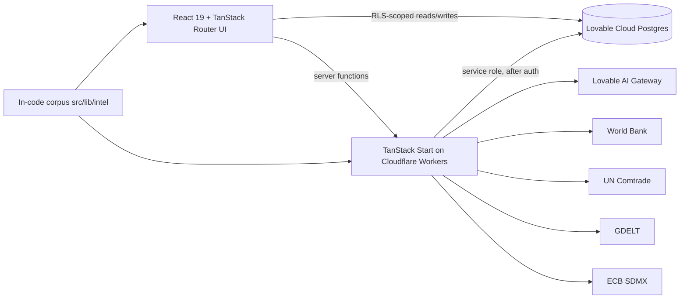

# GlobalMatrix

Geopolitical and supply-chain exposure intelligence. GlobalMatrix links geopolitical events (tariffs, sanctions, export controls, chokepoint disruptions, conflicts) to the countries, trade flows, industries and infrastructure they can affect, and shows the evidence behind each assessment.

**Intended users:** risk analysts, importers, manufacturers, supply-chain and policy teams.

## What is implemented

- Landing page with world map, global pulse and event feed
- 21 in-app pages under `/app` (overview, world, events, event detail, countries, country detail, industries, industry detail, supply, chain, trade, markets, risk, scenarios, graph, data, watchlist, analyst, companies, policy, analogues)
- Deterministic scoring engine (`src/lib/intel/engine`) over a versioned analytical corpus (`src/lib/intel`)
- Email/password and Google sign-in
- Per-user watchlist, annotations, exposure profiles and AI briefs stored in the database
- Data refresh connectors: World Bank, UN Comtrade, GDELT, ECB (see *Data sources*)

**Not yet backed by data:** Companies, Policy and Analogues show an explicit "not available" state.

## Workflow: event → evidence → propagation → exposure

1. An **event** in the corpus carries actors, stage, confidence and a ledger of **signals** (source, source class, timestamp, reliability, corroborations).
2. The engine converts signals into **channel pressure** (e.g. energy, shipping, finance) and a 30/90-day **risk score with an 80% interval**.
3. Pressure **propagates** through country, industry and trade-flow links.
4. Users see **exposure** for countries/industries, and can save their own dependencies in an exposure profile.

Scores use hand-set weights and are not statistically calibrated — treat them as structured assessments, not forecasts.

## Architecture



## Tech stack

| Part | Role |
|---|---|
| React 19, TypeScript | UI |
| TanStack Start / Router, Vite 7 | SSR, file-based routes, server functions |
| Tailwind CSS v4, shadcn/ui | Styling and components |
| Lovable Cloud (Postgres, Auth) | User data, sign-in, row-level security |
| Lovable AI Gateway | Model-written briefs (server-side only) |
| Vitest | Tests |

## Project structure

```
src/
  routes/            file-based routes (index, login, signup, auth, methodology, app/*)
  pages/             page components rendered by routes
  components/        shared UI (components/ui = shadcn, components/viz = charts, maps, Shell)
  lib/intel/         analytical corpus and scoring engine
  lib/backend/       server functions (server.ts) and client data hooks (api.ts, shim.ts)
  lib/sources*.ts    source registry and poll governor
  integrations/      generated backend client (do not edit)
  test/              Vitest tests
```

## Setup

Prerequisites: Node.js 20+ or Bun.

```sh
bun install
bun run dev        # development server
bun run test       # tests
bun run build      # production build
bunx tsgo --noEmit # type check
```

### Environment variables (names only)

| Name | Where | Purpose |
|---|---|---|
| `VITE_SUPABASE_URL`, `VITE_SUPABASE_PUBLISHABLE_KEY`, `VITE_SUPABASE_PROJECT_ID` | client | Backend connection (publishable) |
| `SUPABASE_URL`, `SUPABASE_SERVICE_ROLE_KEY` | server only | Privileged writes after the caller is verified |
| `LOVABLE_API_KEY` | server only | AI Gateway access for briefs |

In Lovable these are managed automatically. Never commit `.env` or key files.

## Auth and database

Tables: `watchlist`, `annotations`, `exposure_deps`, `briefs`, `brief_claims` (user-owned, RLS limited to `auth.uid()`), and `observations`, `source_runs`, `source_locks` (public read, written only by server functions). Email sign-up requires confirmation.

## Data sources

| Source | Status |
|---|---|
| World Bank indicators | Connector implemented; refresh on demand |
| UN Comtrade | Connector implemented; may be rate-limited without a key |
| GDELT headlines/attention | Connector implemented; public endpoint, can be slow or unavailable |
| ECB FX and yields | Connector implemented |
| Event corpus | Curated, versioned, in code (not live) |

Each observation stores source, as-of date, retrieval time and status. Refreshes are throttled by a poll governor; failures are recorded and the page keeps prior data.

## AI briefs

- Generated server-side for signed-in users, one per 20 seconds per user.
- The prompt contains only the event's evidence ledger and the engine's deterministic output; the model is told not to add facts.
- Output is validated JSON (thesis ≤2000 chars, ≤4 channels, ≤5 caveats); malformed output, timeouts (45 s), rate limits and exhausted credits return clear messages.
- Briefs are **model interpretations**, not verified facts. The evidence ledger is the source of record.

## Security

- Row-level security on every table; user data is readable only by its owner.
- Model and service-role calls run on the server; inputs are validated there.
- A private key file (`.env.keys`) existed in the earlier repository history — rotate any keys it contained.

## Deployment

Publish from the Lovable editor. The app runs on Cloudflare Workers; the backend is Lovable Cloud.

## Troubleshooting

- **Brief says AI service busy / credits exhausted** — retry later or add workspace credits.
- **Source shows unavailable** — the upstream API failed; retry after the cooldown shown.
- **Sign-up gives no session** — confirm the email link first.

## Roadmap

Implemented: everything listed above. Planned: data for Companies/Policy/Analogues, calibrated scoring, more end-to-end tests.

## Contributing

Open an issue or pull request. No license has been declared yet.
