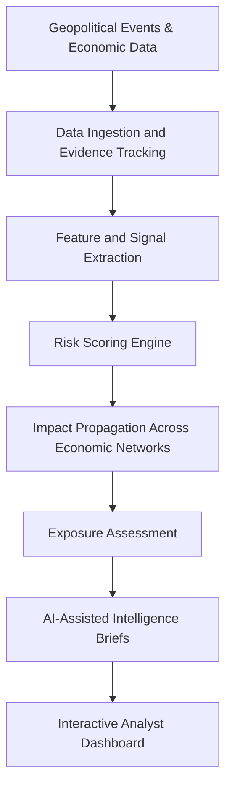

# GlobalMatrix
### AI-Powered Geopolitical Risk & Supply-Chain Intelligence

**From global events to explainable, data-driven risk insights.**

GlobalMatrix is an AI-assisted intelligence platform designed to analyze how geopolitical disruptions can affect countries, industries, and international supply chains.

It combines external economic data, structured event evidence, deterministic risk scoring, impact propagation, and AI-generated analytical briefs to help users understand **what happened, where exposure may emerge, how impacts could spread, and what evidence supports the assessment.**

## Core Intelligence Capabilities

- **AI-Assisted Risk Analysis:** Generate structured intelligence briefs grounded in available event evidence and analytical outputs.
- **Explainable Risk Engine:** Transform event signals into channel-level pressure and 30/90-day risk assessments using configurable scoring rules.
- **Impact Propagation Modeling:** Trace potential disruption pathways across countries, industries, and trade relationships.
- **Evidence-Aware Intelligence:** Track source attribution, timestamps, reliability indicators, and corroborating signals to improve transparency.
- **Economic Data Integration:** Connect external data sources, including World Bank, UN Comtrade, GDELT, and ECB.
- **Personalized Risk Monitoring:** Maintain watchlists, annotations, exposure profiles, and saved analytical briefs.

## Intelligence Pipeline



## AI/ML Engineering Direction

The platform establishes a foundation for more advanced machine learning capabilities:

- **Risk Prediction:** Future development of supervised models trained and evaluated on historical disruption data.
- **Anomaly Detection:** Identify unusual changes in economic indicators and trade patterns.
- **Graph-Based Learning:** Explore graph machine learning to model dependencies and potential risk propagation.
- **NLP for Event Intelligence:** Extract entities, event types, and relationships from news and policy documents.
- **Model Evaluation:** Introduce historical backtesting, baseline comparisons, calibration, and drift monitoring.

*These advanced ML capabilities are planned extensions, not claims about the current implementation.*

## Technology Stack

- **Frontend:** React 19, TypeScript, Tailwind CSS v4, shadcn/ui
- **Backend:** TanStack Start, server functions, Cloudflare Workers
- **Database & Authentication:** PostgreSQL, Lovable Cloud, row-level security
- **AI Integration:** Lovable AI Gateway, structured AI outputs
- **Data Sources:** World Bank, UN Comtrade, GDELT, ECB SDMX
- **Testing:** Vitest

## Getting Started

Requirements: Node.js 20+ or Bun.

```bash id="m6qs2b"
git clone <YOUR_REPOSITORY_URL>
cd <YOUR_PROJECT_DIRECTORY>
bun install
bun run dev
```

Run validation checks:

```bash id="c3sm2a"
bun run test
bunx tsgo --noEmit
bun run build
```

Configure environment variables through deployment settings. Never commit API keys or privileged credentials.

## Reliability & Responsible Analysis

Risk assessments currently use configurable, manually defined weights; their intervals are not statistically calibrated confidence intervals. AI-generated briefs interpret available evidence and do not independently verify facts. Data freshness depends on external source availability.

## Roadmap

- Build and evaluate historical-event ML datasets.
- Develop validated risk prediction and anomaly detection models.
- Introduce graph-based exposure analysis and NLP event extraction.
- Add backtesting, model calibration, and monitoring.

---

**GlobalMatrix — AI-assisted intelligence for understanding how global disruption propagates through the economy.**
