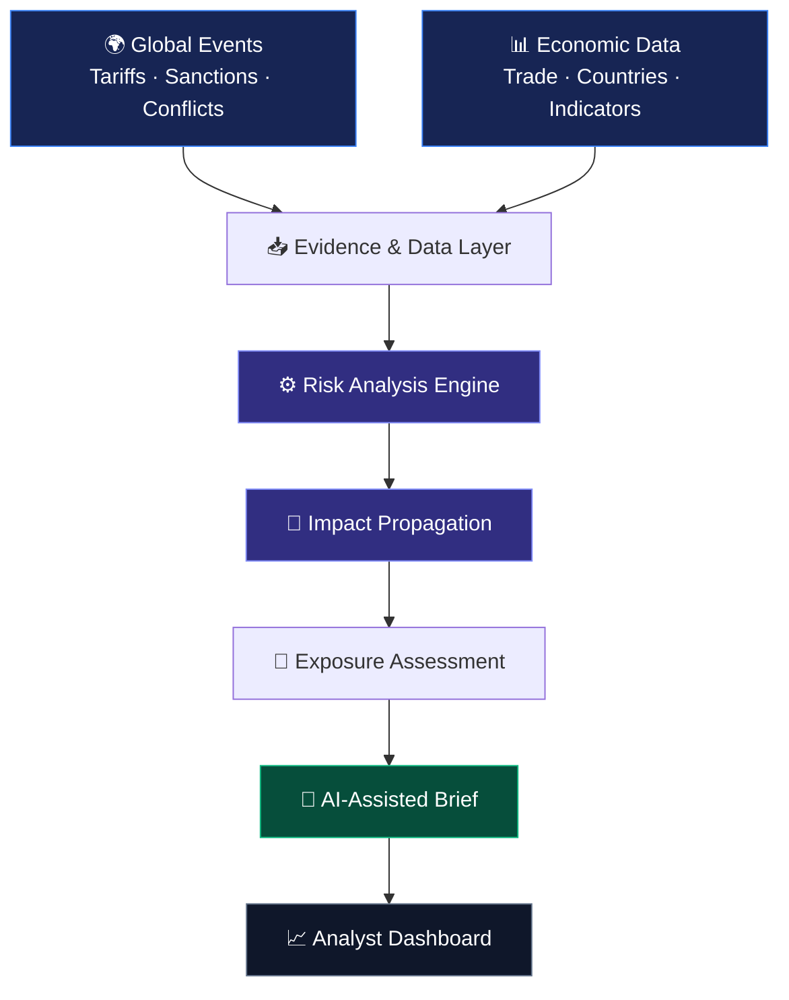
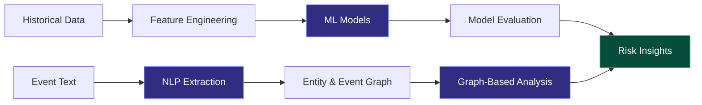
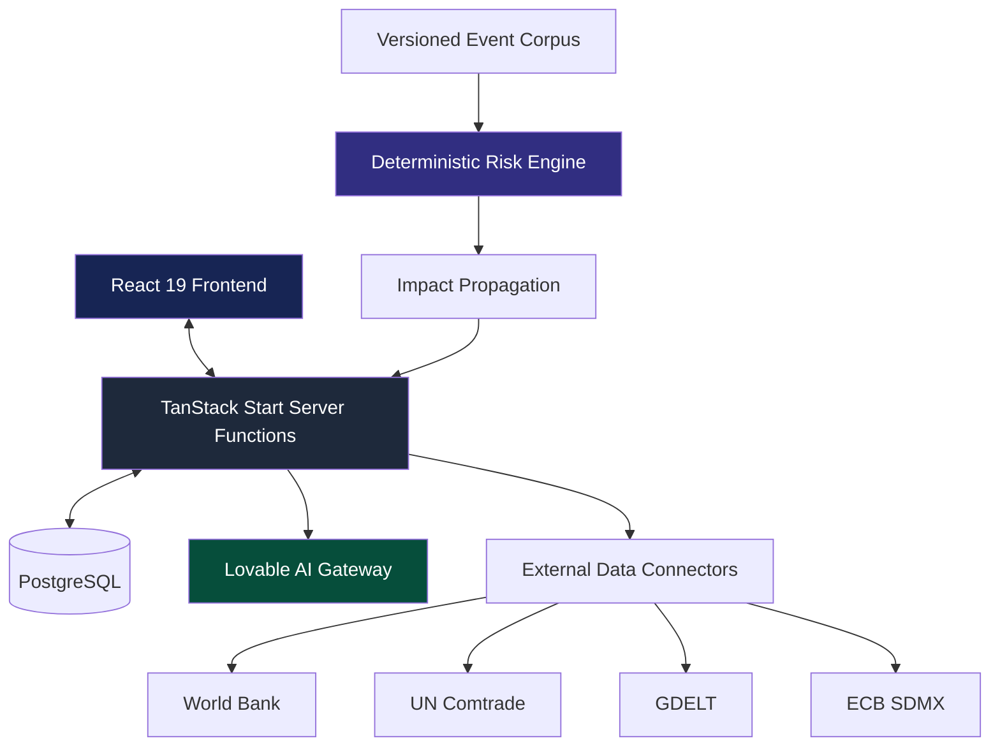

# 🌐 GlobalMatrix
### AI-Powered Geopolitical Risk & Supply-Chain Intelligence

> **Understand global events. Trace their impact. Identify potential exposure.**

GlobalMatrix is an intelligence platform that connects geopolitical disruptions with economic data and supply-chain relationships. It combines evidence-based risk scoring, impact propagation, external data integrations, and AI-assisted analysis to explain how events may affect countries, industries, and international trade.

## 🧠 How GlobalMatrix Works



## ✨ Core Capabilities

| Capability | What it does |
|---|---|
| 🌍 Geopolitical Intelligence | Explore events, countries, industries, markets, and trade flows |
| ⚙️ Risk Scoring | Calculate channel pressure and 30/90-day risk assessments |
| 🔗 Impact Propagation | Model how disruptions may spread through economic relationships |
| 🔎 Evidence Tracking | Inspect source attribution, timestamps, reliability, and corroboration |
| 🤖 AI-Assisted Analysis | Generate structured intelligence briefs from available evidence |
| 📌 Personalized Monitoring | Save watchlists, annotations, and exposure profiles |

## 🤖 AI/ML Roadmap

The current system combines deterministic risk scoring with AI-assisted interpretation. These planned extensions would introduce evaluated machine-learning models.



**Planned ML capabilities**
- **Risk prediction:** Train and evaluate models on historical disruptions.
- **Anomaly detection:** Identify unusual changes in trade and economic indicators.
- **Natural language processing:** Extract events, entities, and relationships from text.
- **Graph machine learning:** Investigate connected economic dependencies and exposure pathways.
- **Model validation:** Backtesting, baseline comparisons, calibration, and drift monitoring.

## 🏗️ System Architecture



## 🛠️ Technology Stack

- **Frontend:** React 19, TypeScript, TanStack Router, Tailwind CSS v4, shadcn/ui
- **Backend:** TanStack Start, server functions, Cloudflare Workers
- **Database & Auth:** PostgreSQL, Lovable Cloud, row-level security
- **AI:** Lovable AI Gateway with structured output validation
- **Data:** World Bank, UN Comtrade, GDELT, ECB SDMX
- **Testing:** Vitest

## 🚀 Run Locally

**Requirements:** Node.js 20+ or Bun.

```bash
git clone <YOUR_REPOSITORY_URL>
cd <YOUR_PROJECT_DIRECTORY>
bun install
bun run dev
```

Validate the project:

```bash
bun run test
bunx tsgo --noEmit
bun run build
```

Configure required environment variables using deployment settings. Never commit API keys or privileged credentials.

## 🔐 Engineering & Reliability

- Row-level security for user-owned records.
- Server-side handling of privileged credentials and AI requests.
- Input validation and structured AI responses.
- Source-refresh throttling and explicit handling of unavailable data.

**Methodology:** Current risk scores use manually configured weights. Reported intervals are not statistically calibrated confidence intervals, and AI-generated briefs are interpretations rather than independently verified facts.

## 🗺️ Development Roadmap

- [ ] Build historical datasets for ML training and evaluation.
- [ ] Implement and benchmark predictive and anomaly-detection models.
- [ ] Add NLP-based event extraction and graph-based analysis.
- [ ] Backtest and calibrate risk assessments.
- [ ] Expand verified company-level exposure intelligence.

---

**GlobalMatrix | Connecting geopolitical events to explainable economic risk.**
